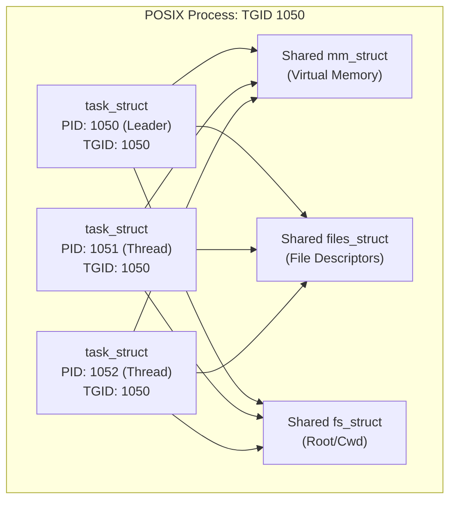
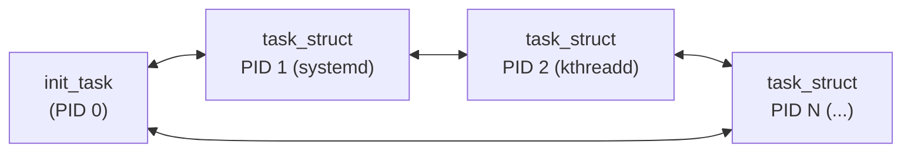
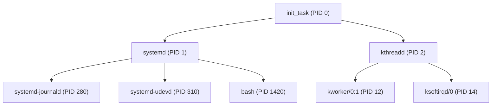

# Architecture: Linux Task Management & Task Lister Module

This document details the architectural foundation of process management in the Linux operating system kernel and explains the structural design of the `task_lister` kernel module.

---

## 1. Operating System Process Abstraction

In modern operating systems, a process is the fundamental abstraction representing an executing program. The operating system kernel is responsible for managing the execution state, virtual address space, open file descriptors, security credentials, and scheduling metadata of all active processes.

In the Linux kernel:
- There is no separate data structure for a "thread" versus a "process".
- Both single-threaded processes and individual threads within a multi-threaded application are represented by the unified `struct task_struct`.
- A multi-threaded process is represented as a collection of `struct task_struct` instances that share an address space (`mm_struct`), signal handlers (`sighand_struct`), and open file table (`files_struct`).
- Tasks belonging to the same POSIX process share the same Thread Group ID (`tgid`), while each individual execution entity possesses a unique Process ID (`pid`).



---

## 2. Process Control Block: `struct task_struct`

The Process Control Block (PCB) in Linux is defined in `<linux/sched.h>` as `struct task_struct`. It is one of the largest and most critical structures in the kernel (spanning several kilobytes).

The `task_lister` module extracts and inspects the following key architectural fields from each `task_struct`:

| Field Name | Type | Architectural Purpose |
| :--- | :--- | :--- |
| `pid` | `pid_t` | Kernel-level unique execution thread identifier. |
| `tgid` | `pid_t` | Thread Group ID, exposed to user space as the POSIX PID. |
| `comm` | `char[TASK_COMM_LEN]` | Name of the binary executable (truncated to 16 bytes). |
| `__state` | `unsigned int` | Current scheduler state bitmask (`TASK_RUNNING`, `TASK_INTERRUPTIBLE`, etc.). |
| `prio` | `int` | Effective dynamic priority used by the scheduler (0–139). |
| `static_prio` | `int` | Static priority assigned at process creation (120 is default/nice 0). |
| `real_parent` | `struct task_struct *` | Pointer to the process that created this task (or inherited upon reparenting). |
| `children` | `struct list_head` | Head of the doubly linked list of child processes. |
| `sibling` | `struct list_head` | Node linking this process into its parent's `children` list. |
| `tasks` | `struct list_head` | Node linking this task into the global circular task list. |
| `mm` | `struct mm_struct *` | Pointer to user-space virtual memory descriptor; `NULL` for kernel threads. |
| `real_cred` / `cred` | `const struct cred *` | Security context containing UID, GID, capabilities, and namespaces. |

---

## 3. Kernel Linked Data Structures

Linux employs circular doubly linked lists implemented via `struct list_head`:

```c
struct list_head {
    struct list_head *next, *prev;
};
```

Instead of embedding data pointers inside the node, Linux embeds the node directly inside the data structure.

### 3.1 The Global Circular Task List
Every process in the system is linked into a circular doubly linked list anchored at `init_task`:



- Traversal begins at `&init_task`.
- The macro `for_each_process(p)` follows `(p)->tasks.next` until returning to `&init_task`.
- Recovery of the enclosing `struct task_struct` pointer from `struct list_head` is performed using `container_of()`.

### 3.2 The Hierarchical Process Tree
Processes form a strict hierarchy rooted at `init_task` (swapper/0) and `systemd` (PID 1):



- Each parent task maintains `task->children` (a `struct list_head`).
- Each child task links into its parent's list through `child->sibling`.
- Depth-First Search (DFS) traverses this graph down to leaf processes.

---

## 4. User Space vs. Kernel Threads

An important distinction demonstrated by the architecture is distinguishing User Space Processes from Kernel Threads:
- **User Space Processes**: Created via `fork()`/`clone()`. They execute application logic in Ring 3 and transition to Ring 0 during system calls. Their `task->mm` points to a valid virtual address space (`struct mm_struct`).
- **Kernel Threads**: Created via `kthread_create()`. They execute kernel routines entirely in Ring 0 without user-space mappings. Consequently, `task->mm == NULL` (they borrow the active `active_mm` of previously running tasks when scheduled).

The `task_lister` module classifies every task:
```c
const char *type_str = task->mm ? "user" : "kernel";
```

---

## 5. Subsystem Integration: Procfs and Seq_File

Rather than relying solely on the kernel ring buffer (`dmesg`), the module exports its data to user space via the Virtual File System (VFS) pseudo-filesystem `procfs`.

```mermaid
graph LR
    User["User Space<br/>cat /proc/task_lister<br/>or reader tool"] 
    --> |read() syscall| VFS["VFS Layer<br/>(Virtual File System)"]
    --> |proc_ops / single_open| Seq["seq_file Interface<br/>(Dynamic Buffer Management)"]
    --> |callback| Module["task_lister.ko<br/>RCU Critical Section"]
    --> |pointer scan| KernelMem["Kernel Memory<br/>task_struct Linked Lists"]
```

### 5.1 Why `seq_file`?
Standard character device reads and basic procfs handlers populate a single page buffer (`PAGE_SIZE = 4096` bytes). A typical Linux server runs hundreds or thousands of processes, generating tens of kilobytes of output.

The `seq_file` API solves this by:
1. Providing an iterator-driven abstraction.
2. Dynamically growing an internal buffer via `kvmalloc()` whenever output overflows.
3. Managing paginated chunk transfers to user space across multiple `read()` system calls without data loss or memory corruption.
