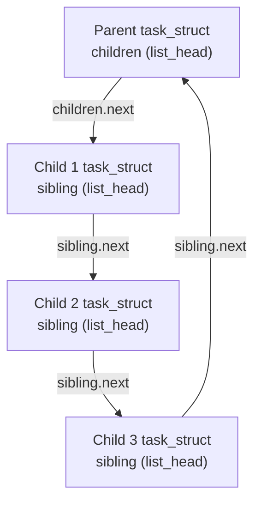

# How It Works: Technical Deep Dive & Implementation Mechanics

This document provides a low-level, technical exploration of how the Linux kernel makes task enumeration possible, analyzing the pointer arithmetic, kernel macros, and data structure traversals utilized by the `task_lister` module.

---

## 1. How Is It Possible? The Kernel's Internal Organization

At any moment, thousands of active threads and processes exist inside the operating system. How does the kernel know about all of them, and how does our module tap into that information?

The answer lies in two global architectural anchors maintained by the Linux scheduler:
1. **The Root Process Symbol (`init_task`)**: Statically allocated at kernel compile time, representing Process 0 (the Swapper/Idle process).
2. **Circular Linked List Embedding**: Every process created thereafter via `fork()` or `clone()` is spliced into a global circular list connected to `init_task`.

Because `init_task` is exported by the kernel (`EXPORT_SYMBOL(init_task)`), loadable kernel modules can access it directly to begin traversing all active tasks in memory.

---

## 2. Macro Analysis: `for_each_process`

The primary engine for linear traversal is the kernel macro `for_each_process(p)`, defined in `<linux/sched/signal.h>`:

```c
#define next_task(p) \
    list_entry_rcu((p)->tasks.next, struct task_struct, tasks)

#define for_each_process(p) \
    for (p = &init_task ; (p = next_task(p)) != &init_task ; )
```

### 2.1 Step-by-Step Mechanics:
1. `p` is initialized to point to `&init_task`.
2. On each iteration, `next_task(p)` fetches `(p)->tasks.next`.
3. The address of `(p)->tasks.next` is not the address of the next `struct task_struct`; it is the address of the `tasks` member within the next `task_struct`.
4. `list_entry_rcu` uses pointer arithmetic (`container_of`) to shift backward from the member address to the base address of the containing `task_struct`.
5. The loop terminates when `next_task(p)` loops around the circular ring and lands back on `&init_task`.

---

## 3. The Mathematics of `container_of`

Linux linked lists do not store `void *data` pointers. Instead, `struct list_head` nodes are embedded directly inside data structures. 

To convert a pointer to an embedded `struct list_head tasks` back into a pointer to the enclosing `struct task_struct`, Linux uses the `container_of()` macro:

```c
#define container_of(ptr, type, member) ({                  \
    void *__mptr = (void *)(ptr);                           \
    BUILD_BUG_ON_MSG(!__same_type(*(ptr), ((type *)0)->member) && \
                     !__same_type(*(ptr), void),            \
                     "pointer type mismatch in container_of()"); \
    ((type *)(__mptr - offsetof(type, member)));            \
})
```

### Memory Layout Visualization:

```
+-------------------------------------------------------+  <-- Base pointer of struct task_struct
| pid_t pid;                                            |
| pid_t tgid;                                           |
| ... other fields ...                                  |
|                                                       |
| offsetof(struct task_struct, tasks)                   |
|                      v                                |
| +--------------------+------------------------------+ |
| | struct list_head tasks;                           | |  <-- Pointer ptr (p->tasks.next)
| |   struct list_head *next;                         | |
| |   struct list_head *prev;                         | |
| +---------------------------------------------------+ |
| ... remaining fields ...                              |
+-------------------------------------------------------+
```

### The Calculation:
$$\text{Base Address} = \text{Address}(\text{ptr}) - \text{offsetof}(\text{struct task\_struct}, \text{tasks})$$

This computation happens in $O(1)$ time with zero memory lookups or dereferencing steps, achieving maximum CPU instruction efficiency.

---

## 4. Traversing the Process Hierarchy: Children & Siblings

While `tasks` forms a flat circular list, the parent-child relationship is structured as an **n-ary tree** implemented via two linked list fields:

```c
struct list_head children;  // Head of list for this task's offspring
struct list_head sibling;   // Entry linking this task to its parent's children list
```



### The Traversal Code:
```c
list_for_each_entry(child, &task->children, sibling) {
    dfs_traverse_tasks(child, m, log_to_dmesg, depth + 1, stats);
}
```

1. `&task->children` serves as the list head for all children of `task`.
2. Each child's `sibling` list node points to the next sibling.
3. `list_for_each_entry` repeatedly applies `container_of` using the `sibling` offset to navigate from one child to the next.
4. For each child, the function calls itself recursively with `depth + 1`, producing the hierarchical tree structure.

---

## 5. Decoding Process State Bitmasks

In Linux 5.14 and newer (including kernel 6.x and 7.x), task state is stored in `task->__state`. The kernel represents states using bit flags:

- `TASK_RUNNING` ($0x00000000$): The task is either currently executing on a CPU or waiting in a runqueue.
- `TASK_INTERRUPTIBLE` ($0x00000001$): The task is sleeping, waiting for an event/signal.
- `TASK_UNINTERRUPTIBLE` ($0x00000002$): Deep sleep waiting for I/O (e.g. disk access); ignores signals.
- `__TASK_STOPPED` ($0x00000004$): Task stopped by `SIGSTOP` or `SIGTSTP`.
- `__TASK_TRACED` ($0x00000008$): Task stopped by a debugger (`ptrace`).
- `EXIT_DEAD` / `EXIT_ZOMBIE`: Task terminated, awaiting parent reclamation via `wait4()`.

To decode these flags without fragile manual bit shifts, `task_lister` relies on the kernel's native helper:
```c
char state_ch = task_state_to_char(task);
```
Inside the kernel, this computes:
$$\text{Index} = \text{fls}(\text{state})$$
where `fls()` is the architecture-accelerated "Find Last Set" bit instruction (e.g. `BSR` or `LZCNT` on x86). It maps the bitmask to a character array:
```c
static const char state_char[] = "RSDTtXZPI";
```
- `R`: Running
- `S`: Sleeping (Interruptible)
- `D`: Disk Sleep (Uninterruptible)
- `T`: Stopped
- `t`: Tracing Stop
- `X`: Dead
- `Z`: Zombie
- `P`: Parked
- `I`: Idle

---

## 6. Zero-Copy User Space Export via `seq_file`

When data is output to user space, `task_lister` does not allocate a giant contiguous buffer. Instead, it hooks into the kernel `seq_file` subsystem via `proc_create_single()`:

```c
entry_linear = proc_create_single("task_lister", 0444, NULL, proc_linear_show);
```

### Buffer Management:
1. `seq_file` maintains an internal memory buffer (`m->buf`).
2. When `seq_printf(m, ...)` is called, data is formatted directly into `m->buf`.
3. If the formatted output would exceed `m->size`:
   - `seq_printf` sets an overflow flag (`m->count = m->size`).
   - The kernel detects overflow, discards the partial buffer, allocates a new buffer of double capacity via `kvmalloc()`, and replays `proc_linear_show()`.
4. Once the buffer is successfully populated, the kernel's `seq_read()` helper transfers pages to the user space buffer via `copy_to_user()`.
5. This guarantees that whether a system has 50 tasks or 50,000 tasks, memory allocation is always exactly right-sized and leak-free.
