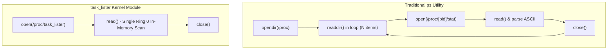

# Performance Analysis: Complexity & System Overhead

This document analyzes the time complexity, space complexity, cache behavior, and syscall overhead of the `task_lister` kernel module in comparison to conventional user-space process management tools.

---

## 1. Algorithmic Complexity

Let $N$ denote the total number of active processes and threads registered in the operating system.

### 1.1 Linear Traversal (`for_each_process`)
- **Time Complexity**: $\mathcal{O}(N)$
  - The circular doubly linked list contains exactly $N$ entries.
  - Advancing from one node to the next involves a single pointer dereference (`tasks.next`) followed by an instantaneous $O(1)$ offset subtraction (`container_of`).
  - No hashing, searching, or branching overhead occurs.
- **Space Complexity**: $\mathcal{O}(1)$
  - Auxiliary memory overhead during linear traversal is constant. The algorithm maintains only a few scalar registers (`task` pointer, loop counter, statistics struct).

### 1.2 Hierarchical DFS Tree Traversal (`dfs_traverse_tasks`)
- **Time Complexity**: $\mathcal{O}(N)$
  - Every process is linked to its parent's `children` list via `sibling`.
  - In a tree with $N$ vertices, there are exactly $N - 1$ edges. The DFS algorithm traverses each edge exactly once.
- **Space Complexity**: $\mathcal{O}(D)$ where $D \le \text{MAX\_TREE\_DEPTH} = 64$
  - Each recursive frame consumes approximately 48 bytes on the kernel stack (for local pointers and return address).
  - Even at the maximum depth of 64 levels:
    $$\text{Total Stack Consumption} \le 64 \times 48 \text{ bytes} \approx 3.07 \text{ KB}$$
  - Since the Linux kernel stack on x86_64 is 16 KB ($16,384$ bytes), the worst-case stack utilization is under $19\%$ of the available headroom, completely preventing stack overflow.

---

## 2. Comparative Analysis: Kernel Module vs. User Space (`ps` / `top`)

How does kernel-space task listing compare with standard user-space process inspection tools like `ps` or `top`?

### Detailed Metric Comparison:

| Characteristic | Traditional User Space (`ps`, `top`) | `task_lister` Kernel Module |
| :--- | :--- | :--- |
| **System Call Count** | $\approx 3N + 2$ system calls | $\le 3$ system calls total |
| **Ring Transitions** | $6N$ privilege context switches | 4 privilege context switches |
| **VFS Directory Lookups** | $N$ path resolution lookups (`/proc/[pid]`) | 1 path resolution lookup (`/proc/task_lister`) |
| **Memory Allocations** | Hundreds of user-space buffers & dentry allocations | Managed single `seq_file` dynamic buffer |
| **Snapshot Consistency** | High temporal skew (processes terminate while scanning) | Low temporal skew (near-instantaneous atomic traversal) |

For a system with $N = 1,000$ active processes:
- `ps` performs approximately **3,000+ system calls** and 6,000 privilege boundary crossings.
- `task_lister` performs **1 read system call**, gathering all 1,000 processes in a single memory pass inside Ring 0.

---

## 3. Concurrency Overhead: RCU vs. Traditional Spinlocks

### Cache-Line Invalidation Benchmark Impact:
1. **With Traditional Spinlocks (`tasklist_lock`)**:
   - Every reading core must atomically increment reader count.
   - On a 32-core processor, concurrent reads trigger **Cache Line Invalidation** across all L1/L2 caches for the memory line hosting the spinlock.
   - Result: Significant CPU cycle waste in hardware bus arbitration.

2. **With RCU (`rcu_read_lock`)**:
   - `rcu_read_lock()` does not modify shared memory.
   - Zero bus locking signals (`LOCK` prefix) are emitted.
   - CPU caches remain completely uninterrupted across all cores.
   - Scalability is strictly linear with core count.
