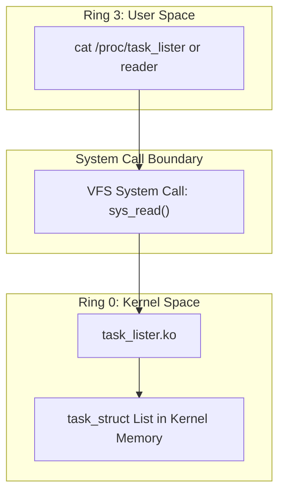

# Principles: Operating Systems Theory & Core Engineering Principles

This document explores the fundamental Operating System concepts, synchronization paradigms, and kernel architectural principles embodied by the `task_lister` module.

---

## 1. Process Control Block (PCB) Abstraction

In operating systems theory, the **Process Control Block (PCB)** is the definitive data structure storing all information necessary to manage a process across its lifecycle.

The `task_lister` module validates the classical PCB model directly from the Linux implementation:
- **Identification**: Process ID (`pid`) and Parent Process ID (`ppid`).
- **Execution State**: Scheduler flags (`__state`) representing Ready, Running, Waiting, Stopped, or Zombie.
- **CPU Scheduling Information**: Static priorities, dynamic priorities (`prio`), and nice values (`task_nice()`).
- **Memory Management Information**: Memory descriptor pointer (`mm`), distinguishing virtual address spaces from non-mapped kernel workers.
- **Security Context**: Credentials (`struct cred`), UID/GID mappings, and capabilities.

---

## 2. Concurrency and Synchronization: The RCU Paradigm

One of the most complex challenges in modern multiprocessor operating systems is safely traversing dynamic kernel data structures while other CPUs concurrently create (`fork()`), modify, or destroy (`exit()`) nodes.

### 2.1 The Traditional Approach: Reader-Writer Spinlocks
Historically, Linux protected task lists using a global reader-writer lock called `tasklist_lock`:
- Traversing tasks required `read_lock(&tasklist_lock)`.
- Creating or destroying a task required `write_lock_irq(&tasklist_lock)`.

**Architectural Bottleneck**:
On high-core systems, taking a read lock across hundreds of tasks causes cache line bouncing (every core writes to the lock memory location to increment reader counters). This degrades overall system throughput and introduces latency spikes in real-time workloads.

### 2.2 The Modern Approach: Read-Copy-Update (RCU)
The `task_lister` module uses Linux's **Read-Copy-Update (RCU)** synchronization mechanism:

```c
rcu_read_lock();
for_each_process(task) {
    /* Safe traversal */
}
rcu_read_unlock();
```

#### How RCU Works:
1. **Zero Lock Overhead**: `rcu_read_lock()` does not write to memory, take bus locks, or increment atomic variables on non-preemptive kernels. On preemptive kernels, it simply disables preemption or records the read-side nesting depth.
2. **Safe Memory Reclamation**: When a process terminates, its `task_struct` is removed from the linked list via pointer replacement. However, its memory is not freed immediately.
3. **Grace Period**: The kernel waits until all CPUs have completed any active read-side critical sections (a "quiescent state"). Only after this grace period elapses is the memory deallocated via `kfree_rcu()` or call_rcu callbacks.
4. **Result**: The task lister reads a consistent, safe view of the task list without blocking any concurrent `fork()` or `exit()` operations on other cores.

---

## 3. Kernel Memory Constraints & Stack Safety

Operating system design enforces strict operational limits inside supervisor space (Ring 0) compared to user space (Ring 3):

| Metric | User Space (Ring 3) | Kernel Space (Ring 0) |
| :--- | :--- | :--- |
| **Stack Allocation** | Dynamic (up to 8 MB via `ulimit -s`) | Fixed (typically 16 KB total per thread on x86_64) |
| **Stack Overflow Handling** | Page fault signals `SIGSEGV` | Kernel panic / system crash |
| **Paging & Faults** | Demand paged on access | Traversal in atomic context must never sleep or page fault |

### Tree Depth Guard
Because the kernel stack is only 16 KB (shared across interrupt handlers, function calls, and local variables), unrestricted recursive algorithms can easily cause catastrophic stack collisions.

The `task_lister` DFS implementation explicitly enforces a stack boundary:
```c
#define MAX_TREE_DEPTH 64

if (depth >= MAX_TREE_DEPTH)
    return;
```
This guarantees that traversal stack usage is mathematically bounded and completely safe under all system conditions.

---

## 4. The Virtual File System (VFS) and Procfs

The Unix design philosophy states: **"Everything is a file."**

Rather than creating custom system calls or complex ioctls to extract task data, `task_lister` integrates natively with the Virtual File System (VFS) by exposing `/proc/task_lister` and `/proc/task_lister_tree`:

1. **Pseudo-Filesystem**: Unlike disk filesystems (ext4, btrfs), `/proc` is an in-memory synthetic filesystem. Reading from it executes kernel C code rather than fetching disk blocks.
2. **Decoupling**: User-space utilities (`cat`, `grep`, `awk`, Python, custom C tools) consume standard POSIX I/O (`open()`, `read()`, `close()`) without needing kernel header dependencies or specialized libraries.
3. **Paging via `seq_file`**: Memory safety is preserved because `seq_file` streams records sequentially, avoiding massive continuous kernel memory allocations.

---

## 5. Privilege Separation and Protection Rings

The x86-64 architecture implements hardware protection rings:
- **Ring 0 (Supervisor Mode)**: Full execution rights, direct hardware access, unrestricted memory access.
- **Ring 3 (User Mode)**: Constrained instruction set, virtual address sandboxing.



The `task_lister` module illustrates safe data boundary crossing:
1. The kernel module reads sensitive supervisor memory structures (`task_struct`).
2. It sanitizes and translates internal structures (e.g., converting kernel UIDs using `from_kuid(&init_user_ns, ...)`).
3. It copies formatted text across the privilege boundary into the user space buffer via the VFS layer.
4. User programs read process details without requiring elevated privileges (`sudo` or `CAP_SYS_ADMIN`).
