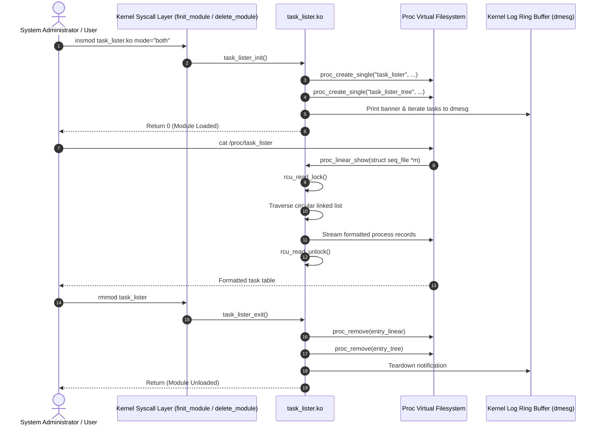

# Working: Execution Flow and Operational Mechanics

This document provides a comprehensive, step-by-step technical explanation of how the `task_lister` kernel module operates from load to unload.

---

## 1. Module Lifecycle Overview

A Loadable Kernel Module (LKM) executes inside supervisor mode (Ring 0). Its operational life cycle is governed by kernel hooks registered during initialization and cleared during removal:



---

## 2. Phase 1: Module Initialization (`task_lister_init`)

When `insmod task_lister.ko` is executed:
1. The kernel loads the ELF object into kernel memory space, resolves dependencies (`init_task`, `init_user_ns`, `proc_create_single_data`), and applies symbol relocations.
2. The module entry point `task_lister_init()` is executed:
   - It parses module parameters (e.g. `mode="linear"`, `"tree"`, or `"both"`).
   - It registers two pseudo-files in `/proc`:
     - `/proc/task_lister` (bound to `proc_linear_show`)
     - `/proc/task_lister_tree` (bound to `proc_tree_show`)
   - If either file creation fails, it handles the error gracefully by unwinding any allocated procfs nodes and returning `-ENOMEM`.
   - If configured, it triggers an immediate traversal run, logging the full process table and hierarchical tree to the kernel log buffer (`dmesg`).

---

## 3. Phase 2: Traversal Execution

### 3.1 Linear Traversal Algorithm (`list_tasks_linear`)
The linear traversal inspects every process currently registered in the kernel's process table:

```mermaid
flowchart TD
    Start([Start Linear Traversal]) --> Lock[rcu_read_lock: Enter Critical Section]
    Lock --> InitPtr[p = &init_task]
    InitPtr --> NextTask[p = next_task(p)]
    NextTask --> CheckEnd{p == &init_task?}
    CheckEnd -- Yes --> Unlock[rcu_read_unlock: Exit Critical Section]
    CheckEnd -- No --> Extract[Extract PID, TGID, State, Prio, Nice, UID, Comm, MM]
    Extract --> Format[Format record via seq_printf or pr_info]
    Format --> UpdateStats[Update Task Statistics Counters]
    UpdateStats --> NextTask
    Unlock --> Summary[Render Summary Statistics Block]
    Summary --> End([Complete])
```

#### Traversal Logic:
1. **Critical Section Entry**: Invokes `rcu_read_lock()` to ensure no `task_struct` memory is reclaimed while pointers are being dereferenced.
2. **List Navigation**: Uses `for_each_process(task)`, which expands to:
   ```c
   for (task = &init_task; (task = next_task(task)) != &init_task; )
   ```
3. **Data Extraction**:
   - `task->pid`: Thread identifier.
   - `task->tgid`: Process group identifier.
   - `task->real_parent->pid`: Parent PID.
   - `from_kuid(&init_user_ns, task_uid(task))`: Numeric User ID.
   - `task_state_to_char(task)`: Translates scheduler state bitmask into a POSIX state flag ('R', 'S', 'D', 'Z', 'T').
   - `task->prio` and `task_nice(task)`: Dynamic and static scheduling priorities.
   - `task->mm ? "user" : "kernel"`: Categorizes process execution boundary.
4. **Summary Aggregation**: Tallies running, sleeping, disk sleep, stopped, and zombie processes.
5. **Critical Section Exit**: Invokes `rcu_read_unlock()`.

---

### 3.2 Hierarchical DFS Traversal Algorithm (`dfs_traverse_tasks`)
The hierarchical view visualizes the parent-child relationships as a process tree starting from PID 0 (`init_task`):

```mermaid
flowchart TD
    DFS_Start["dfs_traverse_tasks(task, depth)"] --> DepthCheck{"depth >= MAX_TREE_DEPTH?"}
    DepthCheck -- Yes --> ReturnEarly[Return: Prevent Kernel Stack Overflow]
    DepthCheck -- No --> BuildIndent[Generate indentation string: '|   ' x depth]
    BuildIndent --> PrintNode["Output: indent + [PID] comm (State, PPID, Type)"]
    PrintNode --> LoopChildren["list_for_each_entry(child, &task->children, sibling)"]
    LoopChildren --> Recurse["dfs_traverse_tasks(child, depth + 1)"]
    Recurse --> LoopChildren
    LoopChildren -- Finished --> Done([Return])
```

#### Tree Logic:
1. **Recursion Depth Guard**: Checks `if (depth >= MAX_TREE_DEPTH)` (`MAX_TREE_DEPTH = 64`). The Linux kernel stack is strictly limited (typically 16 KB on x86_64). Unbounded recursion risks kernel stack exhaustion.
2. **Indentation Formatting**: Generates vertical branch bars (`|   `) corresponding to the recursion level to create a clean tree representation.
3. **Child Navigation**: Navigates the doubly linked list head `task->children` using `child->sibling` pointers:
   ```c
   list_for_each_entry(child, &task->children, sibling) {
       dfs_traverse_tasks(child, m, log_to_dmesg, depth + 1, stats);
   }
   ```

---

## 4. Phase 3: Procfs Request Handling via Seq_File

When a user space utility executes `cat /proc/task_lister`:
1. VFS translates the path to the registered `struct proc_dir_entry`.
2. The `single_open` handler allocates an internal `seq_file` descriptor and associates the `proc_linear_show` callback.
3. The kernel invokes `proc_linear_show(m, v)`.
4. The traversal populates output records using `seq_printf(m, ...)` and `seq_puts(m, ...)`.
5. If the generated output exceeds the current `seq_file` buffer capacity, the kernel automatically reallocates a buffer twice the size and replays the callback.
6. The buffered data is copied across the kernel-user protection boundary to the user space buffer.
7. Subsequent reads return `0` (EOF), closing the stream cleanly.

---

## 5. Phase 4: Module Teardown (`task_lister_exit`)

When `rmmod task_lister` is called:
1. The kernel checks whether any process has open file handles on `/proc/task_lister` or `/proc/task_lister_tree`.
2. Once references reach zero, `task_lister_exit()` is invoked.
3. Both procfs entries are unregistered and deallocated via `proc_remove()`.
4. A teardown confirmation message is sent to `pr_info`.
5. Module code memory is freed safely from supervisor space.
